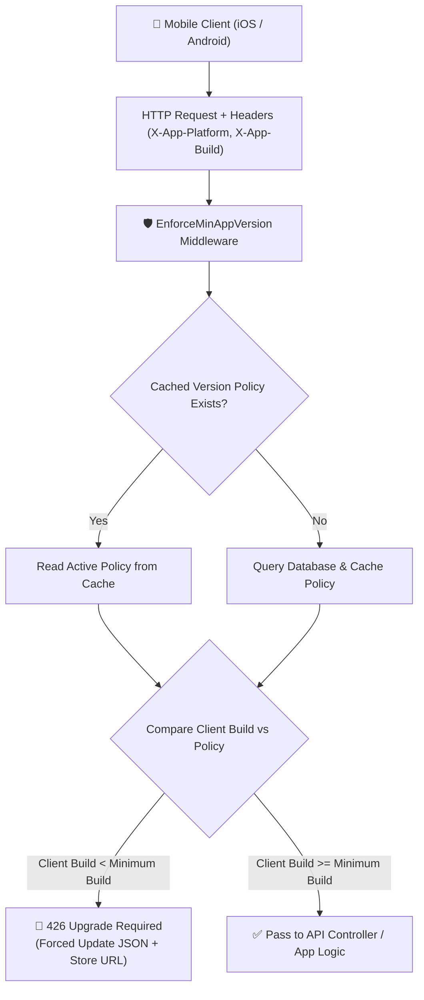

# Laravel App Version Manager & Mobile Force Update Gate

[](https://packagist.org/packages/creatix/app-version-manager)
[](https://packagist.org/packages/creatix/app-version-manager)
[](https://packagist.org/packages/creatix/app-version-manager)
[](https://www.php.net)
[](https://laravel.com)
[](https://github.com/Creatix-Infotech/app-version-manager/actions)

> **Enterprise-grade Laravel package for mobile app version policy enforcement, forced & optional update gates, in-app update checks, and automated App Store & Google Play release synchronization.**

---

## 📖 Table of Contents

- [Overview](#-overview)
- [Why Use App Version Manager?](#-why-use-app-version-manager)
- [Key Features](#-key-features)
- [Architecture & Request Flow](#-architecture--request-flow)
- [Compatibility](#-compatibility)
- [Installation](#-installation)
- [Configuration](#-configuration)
- [Usage Guide](#-usage-guide)
  - [1. Protecting Routes with Forced Update Middleware](#1-protecting-routes-with-forced-update-middleware)
  - [2. Mobile App Launch Version Check Endpoint](#2-mobile-app-launch-version-check-endpoint)
  - [3. Programmatic Usage via Facade](#3-programmatic-usage-via-facade)
  - [4. Automated App Store & Google Play Sync](#4-automated-app-store--google-play-sync)
- [Client Integration Examples](#-client-integration-examples)
  - [Flutter (Dart)](#flutter-dart)
  - [React Native (Axios)](#react-native-axios)
  - [iOS (Swift)](#ios-swift)
  - [Android (Kotlin)](#android-kotlin)
- [Frequently Asked Questions (FAQ)](#-frequently-asked-questions-faq)
- [Testing](#-testing)
- [Changelog](#-changelog)
- [Contributing](#-contributing)
- [Security](#-security)
- [License](#-license)

---

## 🌟 Overview

When maintaining mobile applications (iOS, Android, Flutter, React Native), breaking API changes, deprecated database schemas, and critical security patches require a dependable way to enforce minimum supported app versions.

**App Version Manager** provides a plug-and-play solution for Laravel applications:
- Intercepts requests from outdated builds before they reach your controller logic with **HTTP 426 Upgrade Required**.
- Notifies mobile clients when a newer version is available without blocking functionality (**optional updates**).
- Synchronizes newly published releases directly from **Apple App Store Connect** and **Google Play Developer API**.
- Delivers sub-millisecond response times with **zero database overhead** via smart policy caching.

---

## 💡 Why Use App Version Manager?

| Traditional Approach | With Creatix App Version Manager |
|---|---|
| Hardcoding minimum versions in `.env` or route files | Clean database-driven version management per platform (`ios`, `android`) |
| Manually updating version numbers after every store release | Automatic scheduled background synchronization with App Store & Google Play |
| Checking database on every single mobile API hit | Multi-layer cached policies that eliminate redundant database queries |
| Custom, inconsistent response codes across endpoints | Standardized `HTTP 426 Upgrade Required` with store links & update notes |

---

## 🚀 Key Features

- 🛡️ **Forced Update Middleware Gate**: Intercepts requests containing outdated client build numbers and returns a clean `HTTP 426 Upgrade Required` payload with store URLs.
- 💡 **Optional In-App Update Prompts**: Allows mobile apps to display non-intrusive upgrade prompts when newer features are available.
- ⚡ **Zero-Overhead Caching**: Policies are cached with customizable TTL and automatically invalidated on updates, keeping your API lightning fast.
- 🔄 **Automated Store Sync**: Command-line tool and scheduler task to fetch live release data directly from Apple App Store Connect and Google Play Console.
- 📱 **RESTful Version Check Endpoint**: Ready-to-use `/api/v1/app-version` route for splash screen or launch checks.
- 🔔 **Event-Driven Architecture**: Dispatches `StoreVersionReleased` events to trigger notifications, Slack alerts, or emails when new versions go live.
- 🧩 **Multi-Platform Support**: Tailored configurations for iOS, Android, and cross-platform frameworks (Flutter, React Native, Ionic, Capacitor).

---

## 📐 Architecture & Request Flow



---

## 📦 Compatibility

| Environment | Supported Versions |
|---|---|
| **PHP** | `8.2.x`, `8.3.x`, `8.4.x`, `8.5.x` |
| **Laravel** | `11.x`, `12.x`, `13.x` |
| **Databases** | MySQL, PostgreSQL, SQLite, SQL Server |
| **Client Platforms** | iOS, Android, Flutter, React Native, Swift, Kotlin |

---

## 🛠️ Installation

Install the package via Composer:

```bash
composer require creatix/app-version-manager
```

Publish the package configuration and database migration files:

```bash
php artisan vendor:publish --tag=app-version-manager-config
php artisan vendor:publish --tag=app-version-manager-migrations
```

Execute the database migration:

```bash
php artisan migrate
```

---

## ⚙️ Configuration

The published `config/app-version-manager.php` file allows you to customize headers, cache TTL, API routes, and store API credentials:

```php
return [
    /*
    |--------------------------------------------------------------------------
    | Database Table
    |--------------------------------------------------------------------------
    */
    'table_name' => 'app_versions',

    /*
    |--------------------------------------------------------------------------
    | Request Headers
    |--------------------------------------------------------------------------
    | Custom headers sent by mobile clients to identify platform and build.
    */
    'headers' => [
        'platform' => 'X-App-Platform', // 'ios' or 'android'
        'build'    => 'X-App-Build',    // integer build number (e.g. 42)
    ],

    /*
    |--------------------------------------------------------------------------
    | Version Check API Endpoint
    |--------------------------------------------------------------------------
    */
    'api' => [
        'enabled' => true,
        'prefix'  => 'api/v1',
        'route'   => 'app-version',
    ],

    /*
    |--------------------------------------------------------------------------
    | Cache Settings
    |--------------------------------------------------------------------------
    | Reduces database load by caching current platform policies.
    */
    'cache' => [
        'enabled' => true,
        'ttl'     => 3600, // seconds
    ],

    /*
    |--------------------------------------------------------------------------
    | Store API Credentials
    |--------------------------------------------------------------------------
    | Credentials for App Store Connect and Google Play Developer API.
    */
    'stores' => [
        'appstore' => [
            'issuer_id'   => env('ASC_ISSUER_ID'),
            'key_id'      => env('ASC_KEY_ID'),
            'private_key' => env('ASC_PRIVATE_KEY'),
            'app_id'      => env('ASC_APP_ID'),
        ],
        'googleplay' => [
            'service_account' => env('GOOGLE_PLAY_SERVICE_ACCOUNT'),
            'package_name'    => env('GOOGLE_PLAY_PACKAGE_NAME'),
        ],
    ],
];
```

---

## 💻 Usage Guide

### 1. Protecting Routes with Forced Update Middleware

Apply the `enforce.min.app.version` middleware to any API route or group:

```php
use Illuminate\Support\Facades\Route;

Route::middleware(['api', 'enforce.min.app.version'])->group(function () {
    Route::get('/user/profile', [UserController::class, 'profile']);
    Route::post('/orders', [OrderController::class, 'store']);
});
```

When a mobile client sends a request with headers:
- `X-App-Platform: android`
- `X-App-Build: 12`

If your minimum required build is `15`, the middleware intercepts the request and responds with **HTTP 426 Upgrade Required**:

```json
{
    "success": false,
    "message": "A newer version of the app is required to continue.",
    "code": 426,
    "data": {
        "platform": "android",
        "update_required": "forced",
        "minimum_version": "1.5.0",
        "minimum_build": 15,
        "latest_version": "2.0.0",
        "latest_build": 20,
        "store_url": "https://play.google.com/store/apps/details?id=com.example",
        "update_message": "Please update to continue using the app."
    }
}
```

---

### 2. Mobile App Launch Version Check Endpoint

Call the built-in endpoint on app startup (splash screen) to verify version status:

```http
GET /api/v1/app-version?platform=ios&build=18
```

*(Alternatively, send via headers `X-App-Platform: ios` and `X-App-Build: 18`)*

#### Example Response (Optional Update Available):
```json
{
    "success": true,
    "message": "App version status retrieved successfully.",
    "data": {
        "platform": "ios",
        "update_required": "optional",
        "is_supported": true,
        "latest_version": "2.0.0",
        "latest_build": 20,
        "minimum_version": "1.5.0",
        "minimum_build": 15,
        "store_url": "https://apps.apple.com/app/id123456789",
        "update_message": "A new version with performance improvements is available!"
    }
}
```

#### Status Enum:
- `forced`: Client build is below minimum build. App should block user interaction and redirect to store.
- `optional`: Client build meets minimum build, but a newer release exists. Display a dismissible dialog.
- `none`: Client is running the latest available build.

---

### 3. Programmatic Usage via Facade

Use the `AppVersion` facade anywhere in your Laravel services:

```php
use Creatix\AppVersionManager\Facades\AppVersion;

// Retrieve the active policy model for a given platform
$policy = AppVersion::currentFor('android');

// Check requirement status for a specific build
$check = AppVersion::check('ios', 42);

if ($check['update_required'] === 'forced') {
    // Custom fallback or analytics logging
}
```

---

### 4. Automated App Store & Google Play Sync

Keep your database up-to-date automatically whenever a new build is approved on the stores:

```bash
php artisan app-versions:sync
```

Schedule it in your `routes/console.php` (Laravel 11+):

```php
use Illuminate\Support\Facades\Schedule;

Schedule::command('app-versions:sync')->hourly();
```

When a new version is detected, a `StoreVersionReleased` event is triggered:

```php
use Creatix\AppVersionManager\Events\StoreVersionReleased;
use Illuminate\Support\Facades\Event;

Event::listen(StoreVersionReleased::class, function ($event) {
    // Notify your mobile team or send an alert via Slack/Email
    Log::info("New version released for {$event->platform}: {$event->version} (Build {$event->build})");
});
```

---

## 📱 Client Integration Examples

### Flutter (Dart)

Using a Dio interceptor to handle forced updates globally:

```dart
import 'package:dio/dio.dart';
import 'package:url_launcher/url_launcher.dart';

class ForceUpdateInterceptor extends Interceptor {
  @override
  void onError(DioException err, ErrorInterceptorHandler handler) {
    if (err.response?.statusCode == 426) {
      final storeUrl = err.response?.data['data']['store_url'];
      final message = err.response?.data['message'];
      
      // Show non-dismissible dialog and launch store URL
      launchUrl(Uri.parse(storeUrl), mode: LaunchMode.externalApplication);
      return;
    }
    super.onError(err, handler);
  }
}
```

---

### React Native (Axios)

```javascript
import axios from 'axios';
import { Alert, Linking } from 'react-native';

const api = axios.create({
  baseURL: 'https://api.yourdomain.com',
  headers: {
    'X-App-Platform': Platform.OS, // 'ios' or 'android'
    'X-App-Build': 12,
  },
});

api.interceptors.response.use(
  (response) => response,
  (error) => {
    if (error.response && error.response.status === 426) {
      const { store_url, update_message } = error.response.data.data;
      Alert.alert(
        'Update Required',
        update_message || 'Please update the app to continue.',
        [{ text: 'Update Now', onPress: () => Linking.openURL(store_url) }],
        { cancelable: false }
      );
    }
    return Promise.reject(error);
  }
);
```

---

### iOS (Swift)

```swift
func handleResponse(response: HTTPURLResponse, data: Data) {
    if response.statusCode == 426 {
        if let json = try? JSONSerialization.jsonObject(with: data) as? [String: Any],
           let responseData = json["data"] as? [String: Any],
           let storeUrlString = responseData["store_url"] as? String,
           let storeUrl = URL(string: storeUrlString) {
            DispatchQueue.main.async {
                UIApplication.shared.open(storeUrl)
            }
        }
    }
}
```

---

### Android (Kotlin)

```kotlin
if (response.code() == 426) {
    val errorBody = response.errorBody()?.string()
    val storeUrl = JSONObject(errorBody).getJSONObject("data").getString("store_url")
    val intent = Intent(Intent.ACTION_VIEW, Uri.parse(storeUrl))
    context.startActivity(intent)
}
```

---

## ❓ Frequently Asked Questions (FAQ)

### How does App Version Manager achieve zero database overhead?
When caching is enabled (`config('app-version-manager.cache.enabled')`), the active version policy for each platform is stored in your configured Laravel cache store (Redis, Memcached, DynamoDB, etc.). All incoming mobile API requests read directly from cache without hitting the database. Cache keys are automatically invalidated whenever a policy is created or updated.

### What happens if a request does not contain version headers?
If the configured headers (`X-App-Platform` and `X-App-Build`) are missing, the middleware gracefully allows the request to pass through by default, ensuring non-mobile clients (such as web frontends or webhooks) are never inadvertently blocked.

### Why does the package use HTTP 426 Upgrade Required?
`HTTP 426 Upgrade Required` is the official IETF RFC 7231 standard status code designed specifically to inform clients that the server refuses to perform the request using the current protocol or build and will proceed only after the client upgrades.

### Can I bypass version enforcement in automated testing or local development?
Yes. Simply omit the `X-App-Platform` / `X-App-Build` headers in test suites, or mock the `AppVersion` facade using `AppVersion::shouldReceive('check')->andReturn(...)`.

---

## 🧪 Testing

Run tests with Composer:

```bash
composer test
```

Or invoke PHPUnit directly:

```bash
vendor/bin/phpunit
```

---

## 📜 Changelog

Please see [CHANGELOG.md](CHANGELOG.md) for details on recent releases and updates.

---

## 🤝 Contributing

Contributions, bug reports, and pull requests are welcome! Please review [CONTRIBUTING.md](CONTRIBUTING.md) for guidelines.

---

## 🔒 Security Vulnerabilities

If you discover any security-related issues, please review our [Security Policy](SECURITY.md) or email hello@creatixinfotech.com instead of using the public issue tracker.

---

## 📄 License

The MIT License (MIT). Please see [License File](LICENSE) for more information.

---

<p align="center">
  Crafted with ❤️ by <a href="https://creatixinfotech.com">Creatix Infotech</a>
</p>
